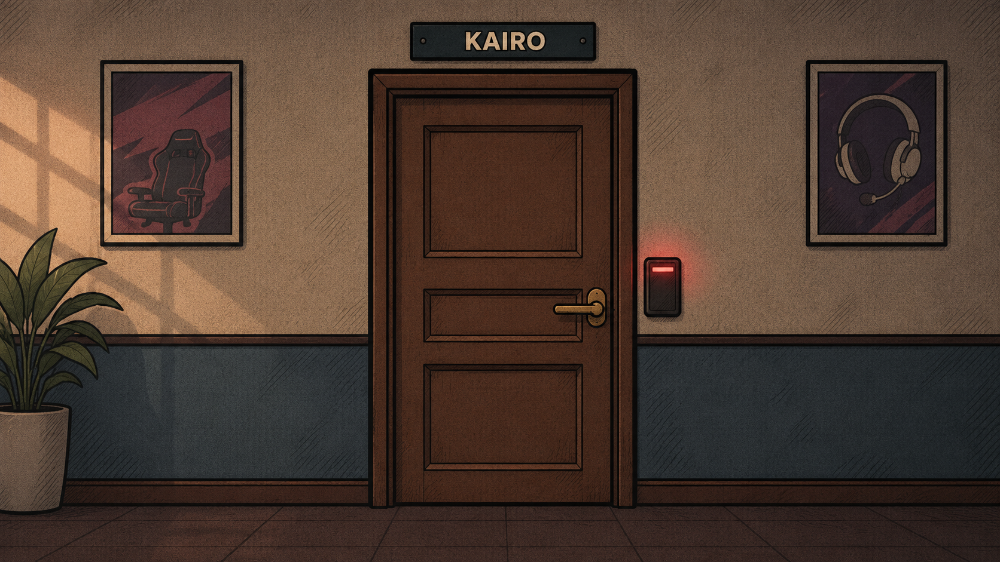

# Protocolo Kairo

[Português](README.pt-BR.md) · English

A browser escape room built with HTML, CSS and vanilla JavaScript. Investigate a missing esports player, connect clues across five rooms and reprogram the exit before the five-minute countdown ends.

This is a student portfolio project by **Gabriel Roberto Dos Santos N. Corrêa**, currently in the second year of a four-year Systems Development course. It documents ongoing learning, with AI assistance disclosed below.



## Play

- [Portuguese website](https://jogo-27g.vercel.app/index.html)
- [English website](https://jogo-27g.vercel.app/en/index.html)
- Choose Português or English on any page. Switching languages starts a new game; progress is not saved between pages or sessions.

The links reflect the repository’s intended deployment routes. New local changes appear online only after deployment.

## Features

- Five connected locations, ten main puzzle objects and an optional trash-bin investigation.
- Four endings determined by remaining time, mistakes and an optional discovery.
- Inventory, investigation log, keyboard controls and clickable arrow buttons.
- Optional binary calculator with place-value explanations and progressive hints. It pauses the countdown while open and does not fill in puzzle answers.
- Optional instrumental soundtrack, responsive layouts, visible focus and alternative text buttons for scene interactions.
- Portuguese and English pages, translated scene signs and shared gameplay rules.

## Run locally

Download or clone the repository, keep its directory structure and open `index.html` in an up-to-date browser. Open `en/index.html` for English. No build step, package installation, backend or database is required. JavaScript must be enabled to play.

To run the automated checks, install Node.js and execute from the project directory:

```sh
node tests/regressao.cjs
```

The suite uses only built-in Node.js modules. Its 42 checks cover game routes, endings, countdown behavior, calculator pause, keyboard/touch-button handlers, optional APIs, contact simulation, both languages and local page references. The DOM and browser APIs are simulated: these checks do not establish visual compatibility across browsers or operating systems. See [COMPATIBILIDADE.md](COMPATIBILIDADE.md) for coverage and pending manual checks.

## Technology and structure

| Technology | Actual use |
| --- | --- |
| HTML | Semantic pages, forms, dialogs and media |
| CSS | Shared visual identity, responsive layout and readable panels |
| JavaScript | Game state, DOM events, puzzles, elapsed-time countdown and translation helpers |
| SVG, PNG and WAV | Scene art, illustrations and optional audio |
| Git / GitHub | Version control and repository |
| Vercel | Static website hosting |
| Node.js | Development-time regression checks only |

```text
*.html                  Portuguese pages
en/                     English pages with matching filenames
css/                    Shared styles
scripts/jogo.js         Shared rules, state and interactions
scripts/contato.js      Demonstration contact form
scripts/idioma.js       Translation and localized asset helpers
scripts/dados/ingles.js English interface dictionary
assets/                 Scenes, portraits, endings and audio
assets/en/              Illustrations containing English text
tests/regressao.cjs     Dependency-free simulated regression suite
```

Python and C are subjects of the author’s studies, but are not used in this project. PHP is planned for the next year of the course and is not part of this implementation. The contact form is a local demonstration and sends no messages.

## Learning and design decisions

The project practices semantic HTML, responsive CSS, functions, objects, arrays, event delegation, state transitions, timers and Git. Source identifiers remain in Portuguese to support the author’s learning; both languages use the same game logic.

The countdown reconciles actual elapsed time when a suspended tab resumes. The binary aid preserves partial seconds during its pause. Fullscreen is optional, and dialogs have an alternative when the native API is unavailable. These choices address concrete failure cases without adding a framework or backend.

Next learning priorities are explaining and modifying the JavaScript independently, checking accessibility with real users and assistive tools, and completing the documented browser/device test matrix.

## Authorship and AI assistance

Gabriel defines the project’s direction and is responsible for its presentation and review. Codex (OpenAI) assisted with implementation, debugging, text revision, translation, educational interactions, documentation and checks. Claude (Anthropic) was also used during development. The door illustration was generated with AI; its generation prompt is recorded in `assets/historia/porta-kairo.prompt.txt`.

AI assistance is part of the development history and is not a claim of unaided implementation or of endorsement by OpenAI or Anthropic. See [the project’s support page](apoio.html) and [credits](CREDITOS.md).

## Possible future distribution

An HTML5 distribution on itch.io is a future option, not a configured release or payment system. Its [official HTML5 guide](https://itch.io/docs/creators/html5) explains ZIP packaging and donation settings. Before publishing there, complete real-browser checks, review asset rights and prepare the release package.

## Contact

[GitHub repository](https://github.com/GabrielRNunes/jogo-27g) · [Email Gabriel](mailto:00gabriel.dosantos@gmail.com)
