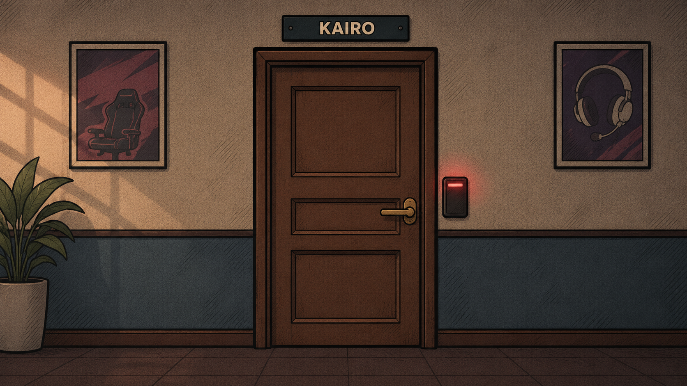

# Protocolo Kairo

Português · [English](README.md)

Escape room para navegador feito com HTML, CSS e JavaScript puro. Investigue o desaparecimento de um jogador de esports, conecte pistas em cinco ambientes e reprograme a saída antes de terminar a contagem de cinco minutos.

Projeto acadêmico e de portfólio de **Gabriel Roberto Dos Santos N. Corrêa**, com o apoio de IA declarado abaixo.



## Acessar e executar

- [Site em português](https://jogo-27g.vercel.app/index.html)
- [Site em inglês](https://jogo-27g.vercel.app/en/index.html)
- O seletor de idioma aparece em todas as páginas. A troca reinicia a partida; não há salvamento de progresso entre páginas ou sessões.

As rotas acima correspondem à publicação prevista do repositório. Alterações locais só aparecem na internet depois do deploy.

Para executar localmente, baixe ou clone o repositório e abra `index.html` em um navegador atualizado, mantendo as pastas. Para inglês, abra `en/index.html`. Não há instalação de dependências, compilação, backend ou banco de dados. O jogo precisa de JavaScript habilitado.

Com Node.js instalado, os testes são executados na pasta do projeto:

```sh
node tests/regressao.cjs
```

São 42 verificações de lógica e estrutura, com DOM e APIs simulados, sem bibliotecas externas. Elas cobrem percursos, finais, relógio, pausa pedagógica, comandos por teclado e botões de toque, APIs opcionais, formulário, idiomas e referências locais. Não substituem testes visuais em navegadores e sistemas reais. A cobertura e as verificações pendentes estão em [COMPATIBILIDADE.md](COMPATIBILIDADE.md).

## O que o projeto oferece

- Cinco ambientes conectados, dez objetos dos enigmas principais e uma investigação opcional na lixeira.
- Quatro finais, inventário, tempo e controles reunidos ao lado da cena em telas largas e antes dela em telas menores, além do diário de investigação com local e tempo das descobertas.
- Apoio binário opcional com explicação dos pesos, exemplo e dicas progressivas. Pausa o relógio enquanto aberto e não preenche respostas dos enigmas.
- Trilha instrumental opcional, painéis legíveis, foco visível e botões textuais alternativos às áreas da imagem.
- Português e inglês, incluindo os textos nas ilustrações, com a mesma lógica de jogo.

## Tecnologias utilizadas

| Tecnologia | Aplicação real |
| --- | --- |
| HTML | Estrutura semântica, formulários, diálogos e mídia |
| CSS | Identidade visual, responsividade e leitura dos painéis |
| JavaScript | Estado, eventos, enigmas, temporizadores e tradução |
| SVG, PNG e WAV | Cenários, ilustrações e áudio opcional |
| Git / GitHub | Histórico de alterações e repositório |
| Vercel | Hospedagem do site estático |
| Node.js | Testes durante o desenvolvimento; não é requisito para jogar |

O formulário de contato é demonstrativo: não envia mensagens.

## Organização e aprendizado

As páginas em português ficam na raiz e as equivalentes em inglês em `en/`. Os estilos ficam em `css/`, as imagens e o áudio em `assets/` e os testes em `tests/`.

`scripts/jogo.js` concentra regras e interações; `scripts/contato.js` contém a simulação do formulário; `scripts/idioma.js` traduz a interface e resolve caminhos de recursos; `scripts/dados/ingles.js` reúne as traduções. Os nomes no código permanecem em português para apoiar o aprendizado, e as duas versões compartilham as regras.

O trabalho exercita HTML semântico, CSS responsivo, funções, objetos, arrays, manipulação do DOM, delegação de eventos, controle de estado e Git. O relógio considera o tempo decorrido, inclusive após a suspensão de uma aba, e preserva frações de segundo durante a pausa da calculadora. Tela cheia é opcional e os diálogos têm alternativa quando a API nativa não existe.

## Autoria e apoio de IA

Gabriel define a direção do projeto e é responsável por sua apresentação e revisão. O Codex, da OpenAI, apoiou implementação, depuração, textos, tradução, recursos pedagógicos, documentação e verificações. O Claude, da Anthropic, também foi utilizado durante o desenvolvimento. A ilustração da porta foi gerada por IA; o prompt está em `assets/historia/porta-kairo.prompt.txt`.

Esse registro torna explícita a assistência recebida. Não representa implementação sem apoio nem endosso das empresas ao projeto. Consulte [Apoio ao Projeto](apoio.html) e [CREDITOS.md](CREDITOS.md).

## Possível distribuição futura

O itch.io é uma possibilidade futura para distribuir o jogo HTML5, com opções descritas no [guia oficial](https://itch.io/docs/creators/html5). Não há publicação ou recebimento de valores configurado neste projeto. Antes dessa etapa, é necessário concluir testes reais, revisar os direitos dos recursos e preparar o pacote de distribuição.

## Contato

[Repositório no GitHub](https://github.com/GabrielRNunes/jogo-27g) · [E-mail](mailto:00gabriel.dosantos@gmail.com)
